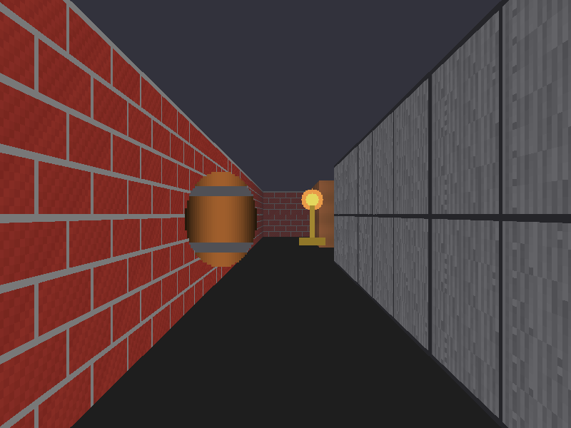

# Wolf — kotiki

Программный raycaster на C++20 и SDL3. ЛР‑2 развивает ЛР‑1: текстуры стен,
буфер глубины, billboard-спрайты с прозрачностью и общий туман стен и предметов.
Изображение строится на CPU в `FrameBuffer`; SDL выводит готовый кадр.



## Сборка и запуск

Нужны CMake 3.24+, компилятор C++20 и SDL3 с CMake-конфигурацией. Например, на macOS:

```sh
brew install cmake sdl3
cmake -S . -B build -DCMAKE_BUILD_TYPE=Debug
cmake --build build
./build/bin/graphics_lab
```

Если GoogleTest не установлен, CMake загружает v1.15.2 из официального репозитория;
для первой конфигурации нужен интернет. Для сборки без тестов: `-DBUILD_TESTING=OFF`.
`GRAPHICS_LAB_VENDORED=ON` предназначен для вручную подготовленного `vendored/SDL`.

По умолчанию открывается `maps/lab02.map`: три текстуры стен и пять предметов.
Бочка и лампа в верхнем коридоре видны сразу после старта. Обойдите внутренние
стены, чтобы увидеть аптечку и предметы в нижнем помещении, их перекрытие стенами
и друг другом. Туман усиливается с глубиной от 4 до 12 единиц.
Исходные карты ЛР‑1 можно открыть отдельно:

```sh
./build/bin/graphics_lab --map maps/default.map --width 800 --height 600
./build/bin/graphics_lab --map maps/maze.map
```

Запускайте из корня проекта или из `build/bin`: CMake копирует карты и ресурсы
рядом с исполняемым файлом. Для запуска из другого каталога передайте абсолютный
путь через `--map`. Неполная карта `maps/bug.map` оставлена как отрицательный
пример: загрузчик сообщает об ошибке ширины строки.

Управление: W/S или ↑/↓ — вперёд/назад, A/D — движение вбок,
Q/E или ←/→ — поворот, Esc или закрытие окна — выход.
`--fullscreen` и `--windowed` переключают режим окна.

## Игровой цикл и вклад участника №1

World / Application / Player — Максим Боймель (Maksim Boimel).
ЛР‑1: карта, игрок, ввод, перемещение, повороты, столкновения и основной цикл.
ЛР‑2: данные сцены, загрузка ресурсов и TextureStore, интеграция текстур,
буфера глубины, готовых SpriteRenderer и Fog в приложение.
Авторство модулей raycasting и software rendering сохраняется в истории Git.

Один кадр выполняется в следующем порядке:

1. `Application::PollInput` обрабатывает события SDL, затем считывает клавиатуру.
2. `PlayerController::Update` обновляет камеру с измеренным временем кадра.
   Время ограничено 50 мс, чтобы после зависания не перескочить стену.
3. `RenderFrame` очищает потолок и пол, вызывает Raycaster, рисует стены
   и заполняет буфер перпендикулярной глубины.
4. SpriteRenderer рисует предметы с тем же буфером глубины и тем же Fog.
5. SdlPresenter передаёт готовый CPU-кадр в окно SDL.

Спавн выбирается в свободной клетке с учётом радиуса игрока. Карта без подходящей
позиции, неизвестный ID изображения предмета или отсутствующий ресурс дают
понятную ошибку запуска. Идентификаторы предметов: 10 — бочка, 11 — лампа,
12 — аптечка. Изображения загружаются один раз, до начала цикла.

Формат карты: число типов стен; строки `id RGB` или `id путь_к_BMP`;
ширина и высота; прямоугольные строки клеток. Поддерживаются компактные строки
из цифр/пробелов и строки числовых ID, разделённых пробелами. Ноль и пробел —
пустая клетка. Необязательная последняя секция: число предметов, затем строки
`x y texture_id [scale]`. Масштаб по умолчанию равен 1.

## Проверка

```sh
ctest --test-dir build --output-on-failure
```

Тесты SDL запускаются с dummy video driver и software renderer, поэтому окно
не требуется. Покрыты DDA, глубина, проекция, движение, карта, BMP-ресурсы,
прозрачность, сортировка предметов и туман. Интеграционные тесты Application
проверяют итоговые пиксели кадра, перекрытие предмета стеной, безопасный спавн,
неизвестные ресурсы и завершение по событию SDL_QUIT.

Сборка с AddressSanitizer и UndefinedBehaviorSanitizer (Clang/GCC):

```sh
cmake -S . -B build/asan -DCMAKE_BUILD_TYPE=Debug \
  -DCMAKE_CXX_FLAGS="-fsanitize=address,undefined -fno-omit-frame-pointer" \
  -DCMAKE_EXE_LINKER_FLAGS="-fsanitize=address,undefined"
cmake --build build/asan
ctest --test-dir build/asan --output-on-failure
```
